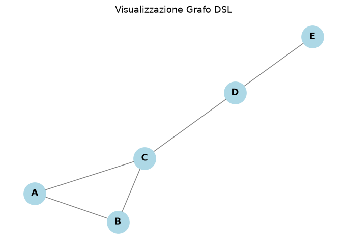

# Graph DSL

A small domain-specific language for building and manipulating undirected graphs, with a full interpreter written in Python: grammar, parser, typed AST, and denotational-style semantics with an explicit environment and store.

Built as the final project for the *Programming Languages with Lab* course (Linguaggi di programmazione con laboratorio). Keywords and code comments are in Italian.



```text
var G1 = {A-B, B-C, C-A};
var G2 = {C-D, D-E};
var G  = UNIONE(G1, G2);
PRINT DISTANZA(G, A, E);
PLOT G
```

```text
OUTPUT >> 3
```

## Language features

| Feature | Syntax |
|---|---|
| Graph literals | `{A-B, B-C, D}` (edges and isolated nodes) |
| Declaration / assignment | `var x = expr` · `x <- expr` |
| Graph operators | `G1 UNIONE G2`, `G1 INTERSEZIONE G2` (also as `UNIONE(G1, G2)`), `INCOLLA(G1, G2, u, v)`, `DISTANZA(G, u, v)` |
| Arithmetic, comparison, logic | `+ - * /` · `== != < > <= >=` · `AND OR` |
| Control flow | `IF c THEN ... ELSE ... ENDIF` · `WHILE c DO ... DONE` |
| User-defined functions | `DEF f(x, y) = expr` (closures, static scoping) |
| Output | `PRINT expr` (text) · `PLOT expr` (networkx + matplotlib window) |

- `INCOLLA` (glue) merges two graphs by identifying node `u` of the first with node `v` of the second, renaming the other nodes to avoid collisions.
- `DISTANZA` computes the shortest path length with a BFS.

## How it works

1. **Parsing**: the grammar is written in EBNF for [Lark](https://github.com/lark-parser/lark).
2. **AST**: the Lark parse tree is converted with structural pattern matching (`match`) into typed `dataclass` nodes, split into *expressions* (which return a value) and *commands* (which change the state).
3. **Semantics**: the interpreter separates the **environment** (names → locations, primitive operators or closures) from the **store** (locations → values). Both are modelled as pure functions, so every update returns a new environment/state instead of mutating the old one.
4. **Functions**: `DEF` creates a closure that captures the environment at definition time (static scoping).
5. **Blocks**: memory allocated inside `IF` and `WHILE` bodies is released when the block ends.

## Running it

Requires Python 3.10+.

```bash
pip install -r requirements.txt
python graph_dsl.py          # runs the 9 built-in example programs
python graph_dsl.py --repl   # interactive interpreter (type `help` for the manual)
```

## Example: static scoping

```text
var x = 10;
DEF f(y) = x + y;
var x = 100;
var risultato = f(1);
IF risultato == 11 THEN
    PRINT {SCOPING-CORRETTO}
ELSE
    PRINT {ERRORE-SCOPING_DINAMICO}
ENDIF
```

`f` keeps seeing the `x` that existed when it was defined, so the result is 11, not 101.

## License

MIT
